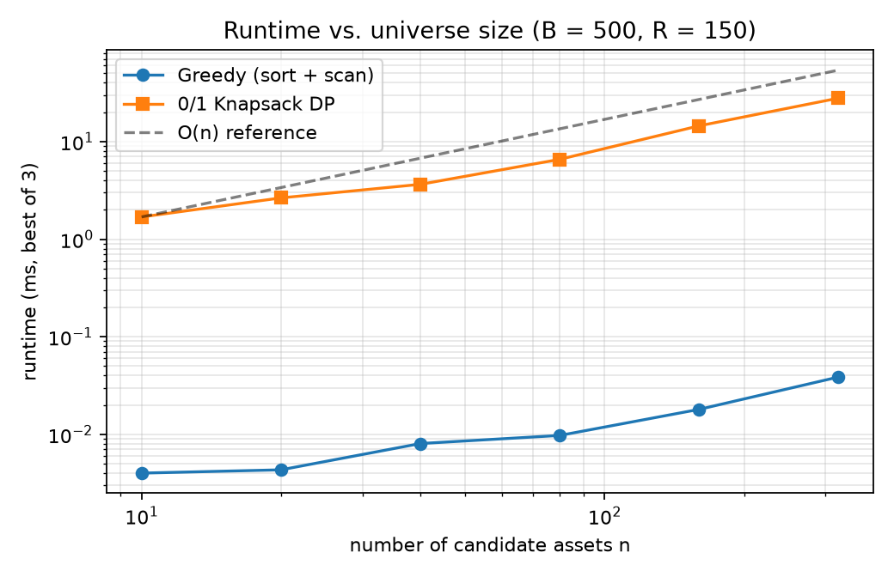
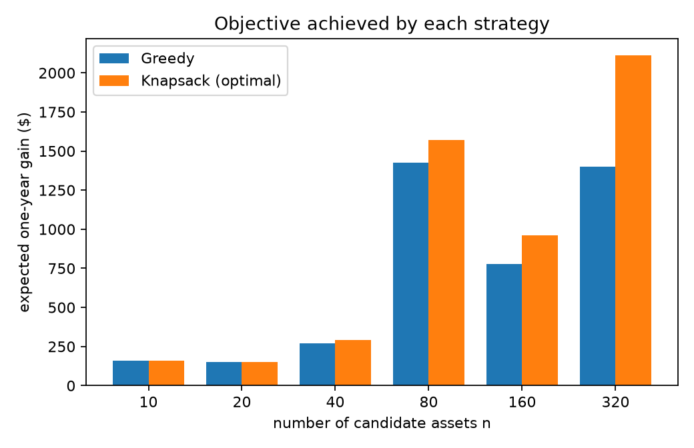
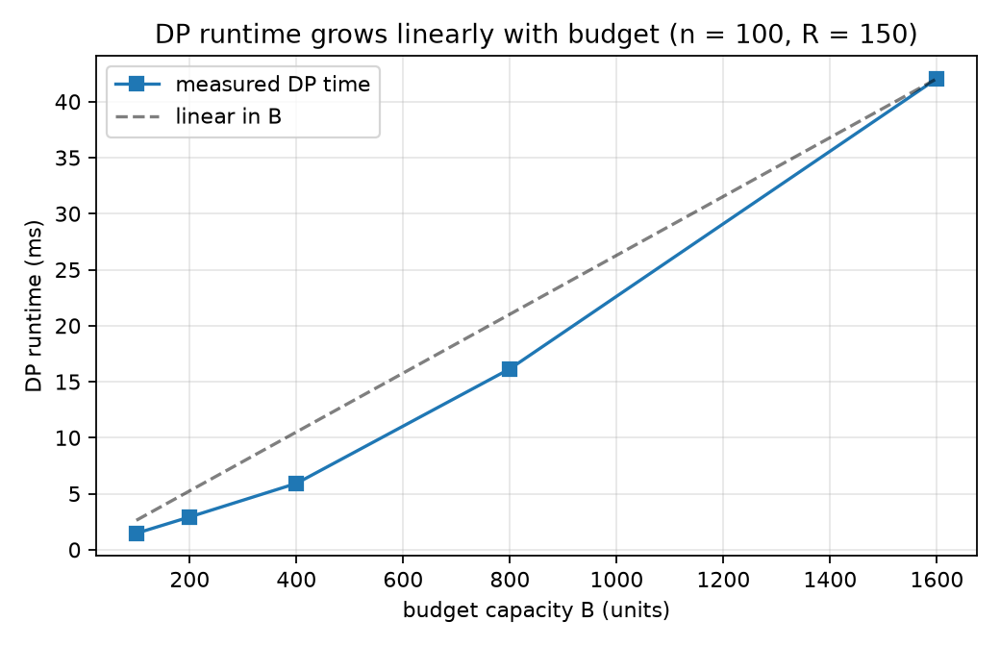
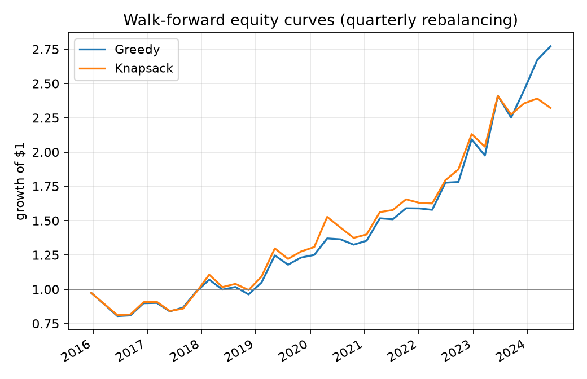

\newpage

# Abstract {.unnumbered}

Institutional and algorithmic investors must choose a subset of securities under a budget
and a risk ceiling. We compare two algorithms for this selection problem: a greedy method
that ranks assets by Sharpe ratio and fills the portfolio in one pass, and an exact 0/1
knapsack solver based on a two-dimensional dynamic program (DP) over budget and risk. We
implement both in Python, verify the DP against exhaustive search, and measure runtime,
objective quality, and walk-forward performance. Greedy is roughly 400 to 800 times faster, but its
objective falls up to 34% below the DP optimum once the candidate universe reaches 320
assets. Surprisingly, in a 20-seed walk-forward sweep the DP's higher *estimated* value did
not translate into better *realised* returns; greedy won on average (paired t = -2.14,
p = 0.045). We attribute this to estimation error in the expected returns, a form of the
optimiser's curse, and discuss how this affects the choice of method in practice.

# Problem Statement

Given $n$ candidate assets, each with a price $p_i$, an expected return $\mu_i$, a
volatility $\sigma_i$, and a Sharpe ratio $s_i = (\mu_i - r_f)/\sigma_i$, choose a subset
$S$ that maximises total expected gain while satisfying

$$\sum_{i \in S} c_i \le B \qquad \text{and} \qquad \sum_{i \in S} k_i \le R,$$

where $c_i = \lceil p_i / \ell \rceil$ is the cost in budget units of lot size $\ell$, and
$k_i = \lceil 100\,\sigma_i \rceil$ is the risk in integer units. Each asset is a binary
decision: buy one share or not. The problem is a 0/1 knapsack with two capacity dimensions,
which is NP-hard in general when $B$ and $R$ are part of the input [@kellerer2004]. Pseudo-polynomial
DP solves it exactly when $B$ and $R$ are bounded integers.

The project asks: how much solution quality does a fast greedy rule lose, and what does the
exact method gain in practice?

# Background

Modern portfolio theory frames investment as a trade-off between expected return and risk
[@markowitz1952]. The Sharpe ratio measures excess return per unit of volatility
[@sharpe1994]. Greedy rules that rank by a single score and add items in order are common
in trading systems because they are simple and fast. Their weakness is well known in
knapsack theory: they can be arbitrarily far from optimal when items are indivisible
[@kellerer2004; @cormen2009]. The standard exact method is dynamic programming over the
capacity dimensions, which costs time proportional to the product of the number of items
and the capacities.

Two related empirical issues matter here. First, estimated expected returns are noisy, and
optimisers tend to select assets whose returns are overestimated [@michaud1989]. Second,
simple heuristics often perform well out of sample compared with optimised portfolios
[@demiguel2009]. Our experiments test the first issue directly.

# Algorithm and Design

## Feature construction

For each asset, the annualised expected return is $\mu = 252\,\bar r$ and the volatility is
$\sigma = \sqrt{252}\,s_r$, computed from daily simple returns in a trailing window of 252
trading days. The Sharpe ratio is $(\mu - r_f)/\sigma$ with $r_f = 0.02$. Only data inside
the window is used, so there is no look-ahead bias.

## Discretisation

Both algorithms receive identical integer items, which makes the comparison fair. Costs
are rounded up, so a solution feasible in units is feasible in dollars and in volatility.
Assets with a missing price, a missing statistic, or zero volatility are excluded and listed
with a reason, since they cannot be scaled to integer units.
This makes the discretised model conservative. With lot size $\ell = \$10$ and risk scale
100, a $5{,}000$ budget gives $B = 500$ units, and a risk ceiling $R = 150$ means that the
sum of annual volatilities can be at most 1.5.

## Greedy selection

Greedy sorts the items by Sharpe ratio in descending order and scans once. It adds each item
if both capacities still hold.

```
GREEDY(items, B, R):
    sort items by sharpe descending                  # O(n log n)
    cost <- 0; risk <- 0; chosen <- []
    for it in items:                                 # O(n)
        if it.value <= 0: continue                   # never buy an asset that loses money
        if cost + it.cost <= B and risk + it.risk <= R:
            chosen.append(it); cost += it.cost; risk += it.risk
    return chosen
```

For a live stream of signals we also provide `StreamingTopK`, a min-heap of size $k$. Each
update costs $O(\log k)$, and the heap keeps the $k$ best Sharpe ratios seen so far without
re-sorting the stream. This is the real-time component of the project.

## 0/1 knapsack by dynamic programming

Let $dp[b][r]$ be the maximum value achievable with at most $b$ budget units and at most $r$
risk units. Processing item $i$ gives the recurrence

$$dp_i[b][r] = \max\bigl(dp_{i-1}[b][r],\; dp_{i-1}[b - c_i][r - k_i] + v_i\bigr),$$

where $v_i = \mu_i p_i$ is the expected one-year dollar gain. Initialising $dp_0 \equiv 0$
gives the "at most" semantics, so $dp[B][R]$ is the optimum. We record one boolean per
state and item, $keep[i][b][r]$, and backtrack from $(B, R)$ to recover the chosen set.

```
KNAPSACK_2D(items, B, R):
    dp <- zeros(B+1, R+1); keep <- false(n, B+1, R+1)
    for i, it in enumerate(items):
        for b from B down to c_i, r from R down to k_i:   # vectorised in NumPy
            if dp[b-c_i][r-k_i] + v_i > dp[b][r]:
                dp[b][r] <- dp[b-c_i][r-k_i] + v_i; keep[i][b][r] <- true
    backtrack from (B, R) using keep; return chosen items, dp[B][R]
```

The complexity is $O(nBR)$ time. The traceback table needs $n(B+1)(R+1)$ bits, but NumPy
stores booleans as bytes, so the table takes $n(B+1)(R+1)$ bytes in this implementation.

# Implementation

The project is organised as a Python package with a command-line interface. Table 1 lists
the main modules and their roles, and the README describes the repository layout.

| Module | Role |
|---|---|
| `features.py` | Returns, volatility, Sharpe ratio; discretisation to integer items |
| `greedy.py` | Batch greedy selection (Sharpe or density key); streaming top-k heap |
| `knapsack.py` | Two-dimensional DP with boolean traceback |
| `brute.py` | Exhaustive search, used only as a correctness oracle |
| `backtest.py` | Walk-forward rebalancing, turnover, realised returns, summaries |
| `benchmark.py`, `plots.py` | Runtime, quality, and memory experiments; figures |
| `main.py` | Commands: `demo`, `benchmark`, `backtest`, `sweep`, `all` |

: Main modules of the implementation and their roles.

The code uses only NumPy, pandas, matplotlib, and SciPy. External ideas are cited in the
references. Design choices are explained in the README, and the code is not reproduced in
this report.

# Testing

We ran 22 unit tests using `unittest`, which requires no extra dependency.

* **Brute-force agreement.** On 300 random instances with $n \le 10$ and capacities up to
  40, the DP value and its traceback value equal the exhaustive optimum (to $10^{-9}$).
* **Greedy never beats DP.** On 200 random instances, the DP value is at least the greedy
  value.
* **Counterexample from the brief.** Budget 10: asset A (cost 10, value 10, Sharpe 1.0)
  against B and C (cost 5, value 6, Sharpe 0.9). Greedy returns A with value 10. The DP
  returns B and C with value 12. This is a regression test for both methods.
* **Constraint compliance.** Greedy and DP outputs respect both capacities in all
  randomised trials, and the backtest checks feasibility at each rebalance.
* **Leakage and formula checks.** The Sharpe ratio matches its definition. Changing prices
  after the window does not change the feature table.
* **Edge cases.** Empty input, items larger than capacity, invalid capacities, and
  non-positive costs raise or return correctly. The streaming top-k structure matches a
  full sort.

All 22 tests pass. They include two regression tests added after the review described in
Appendix B: a greedy run with a negative-value asset, which must not be selected, and a
universe containing a zero-volatility asset, which must be excluded with a stated reason
rather than causing a crash.

# Results

## Demonstration

On a 12-asset universe with a $5,000 budget and risk ceiling 150, greedy by Sharpe ratio
achieves an expected gain of \$819.73, while the DP achieves \$883.37. Brute force
confirms the DP optimum of \$883.37.

## Runtime and quality

Table 2 and Figures 1 and 2 show runtime and objective values as the universe grows. Figure 3
shows that DP runtime grows linearly with the budget, as expected from $O(nBR)$.

| $n$ | Greedy (ms) | DP (ms) | Greedy value (\$) | DP value (\$) | Greedy gap (%) | DP table (MB) |
|---:|---:|---:|---:|---:|---:|---:|
| 10 | 0.004 | 1.69 | 159.6 | 159.6 | 0.0 | 0.76 |
| 20 | 0.004 | 2.65 | 152.6 | 152.6 | 0.0 | 1.51 |
| 40 | 0.008 | 3.65 | 269.1 | 290.0 | 7.2 | 3.03 |
| 80 | 0.010 | 6.58 | 1426.8 | 1568.9 | 9.1 | 6.05 |
| 160 | 0.018 | 14.50 | 777.7 | 960.2 | 19.0 | 12.10 |
| 320 | 0.039 | 27.87 | 1400.0 | 2112.5 | 33.7 | 24.21 |

: Runtime (best of 3), objective, optimality gap, and DP traceback memory with $B = 500$ and $R = 150$.







The greedy gap is zero for some universes and up to 34% for others, so the worst case is not
bounded by a small constant for this input family. This confirms the theoretical concern that
greedy by ratio is not an approximation scheme for 0/1 selection.

## Walk-forward backtest

We simulate 10 years of daily prices for 30 assets from a one-factor model with known
parameters. Each quarter (63 trading days) the strategy estimates statistics from the
trailing 252 days, selects a portfolio, and holds it for one quarter. Table 3 gives the
summary for one seed. Figure 4 shows the equity curves.

| Strategy | Cum. return | CAGR | Ann. vol | Sharpe-like | Mean est. value (\$) | Turnover | Runtime (ms) |
|---|---:|---:|---:|---:|---:|---:|---:|
| Greedy | 177.1% | 12.0% | 16.2% | 0.78 | 675 | 0.53 | 0.02 |
| Knapsack | 132.2% | 9.8% | 16.1% | 0.66 | 771 | 0.43 | 3.38 |

: Walk-forward summary for seed 7 (36 quarterly rebalances, all feasible).



## Robustness over 20 universes

A single seed is not enough. We therefore repeated the backtest on 20 independent synthetic
universes (seeds 1 to 20) and compared the strategies on each one.

* The knapsack's estimated value is at least as high as greedy's at every rebalance, as it
  must, since it optimises that objective exactly on the same discretised items.
* Mean cumulative return: greedy 216.1%, knapsack 185.5%.
* Paired difference (knapsack minus greedy): mean -0.31, knapsack wins on 7 of 20 seeds,
  paired t = -2.14, p = 0.045.

The result is statistically significant at the 5% level but modest in size, and it rests on
one simulated market design. We therefore treat it as evidence, not a settled conclusion.

# Discussion

**Speed versus optimality.** The benchmarks confirm the expected trade-off. Greedy runs in
microseconds to tens of microseconds at every size tested, while the DP takes milliseconds and grows with
$nBR$. For order routing, where latency matters more than the last dollar of value, greedy is
the right tool. For monthly rebalancing with a fixed budget, the DP's time cost is negligible
compared with the decision it supports.

**Why higher estimated value does not mean better realised return.** The DP maximises the
estimated objective $\sum \hat\mu_i p_i$ exactly. Estimated returns are noisy, and the assets
with the largest estimated returns are disproportionately those whose estimates are most
inflated by chance. Selecting on the largest estimates therefore biases the portfolio toward
overestimated assets. This is the optimiser's curse, described by Michaud for mean-variance
optimisation [@michaud1989]. Greedy ranks by Sharpe ratio, which normalises return by
volatility and is therefore less sensitive to extreme expected-return estimates. DeMiguel
and colleagues found similar behaviour, where simple rules often beat optimised portfolios
out of sample [@demiguel2009].

**A confound in our design.** The DP objective is expected dollar gain $\mu p$, which favours
expensive, high-return assets. Greedy ranks by Sharpe ratio, which is risk-adjusted. The two
methods therefore optimise different quantities, so the realised comparison mixes algorithm
effects with objective effects. A cleaner ablation would give both methods the same
objective. We discuss this as future work.

**Turnover.** The DP changed fewer holdings between quarters (turnover 0.43 vs. 0.53). Its
choices are more stable for this seed, which is a small practical advantage.

**Limitations.** The risk model is additive volatility, which ignores correlation. The data
are synthetic, so real-market behaviour is untested. Sharpe estimates from one year of data
are noisy, and the backtest has only 36 rebalances per seed.

# Team Contributions

The full contribution statement, by module and task, is in `CONTRIBUTIONS.md` in the
repository. In summary:

* **[Member A]:** data model, feature construction, greedy selection, streaming top-k heap,
  and repository setup.
* **[Member B]:** two-dimensional DP with traceback, brute-force oracle, and the DP and
  greedy test suites.
* **[Member C]:** data generator, walk-forward backtest, benchmark and sweep experiments,
  figures, and the CLI.

Every member contributed to implementation, report sections, and the recorded demonstration,
as listed in the contribution table in `CONTRIBUTIONS.md`.

# Conclusion

Greedy ranking by Sharpe ratio and exact 0/1 knapsack optimisation solve the same constrained
selection problem with different trade-offs. Greedy is roughly 400 to 800 times faster in our
measurements and suits real-time use. The DP gives the exact optimum of its objective, and its advantage grows with
universe size, reaching a 34% objective gain at 320 assets in our experiments. However, the
optimum of an estimated objective is not the optimum of the true objective. In a 20-seed
walk-forward study, greedy produced higher realised returns on average. The practical lesson
is that an exact optimiser amplifies estimation error, so the choice of method should account
for how reliable the inputs are. Future work includes a common-objective ablation, a
covariance-aware risk constraint through a mixed-integer solver, and validation on real
market data.

# References {.unnumbered}

::: {#refs}
:::

# Appendix A: Reproducing the Results

```
pip install -r requirements.txt
python main.py demo
python main.py benchmark
python main.py backtest
python main.py sweep --seeds 20
python -m unittest discover -s tests -t . -v
```

All synthetic data are seeded, so the numbers in this report can be reproduced exactly.
Extended code is in the GitHub repository and is not reproduced here.

# Appendix B: Corrections Since the First Version

Review of the first version found two defects, both now fixed and covered by regression tests.

* **Greedy bought assets with negative expected return.** Greedy ranked by Sharpe ratio and
  added any asset that fit, even when its expected gain was negative. The DP never does this,
  so the two methods were solving different problems. Greedy now skips such assets. This changed
  the n = 10 benchmark from a 10.6% gap to 0.0%, and changed the 20-seed sweep statistics
  slightly (the earlier draft reported t = -2.25, p = 0.037; the corrected values are reported
  above).
* **Zero-volatility assets crashed the DP.** An asset with a constant price has zero volatility,
  which gives an integer risk of zero. The DP rejects zero-weight items, so the program stopped.
  Such assets are now excluded, and the reason is shown to the user.

The web dashboard (app.py) was added on top of the same algorithm modules. It does not change
any algorithm result.
